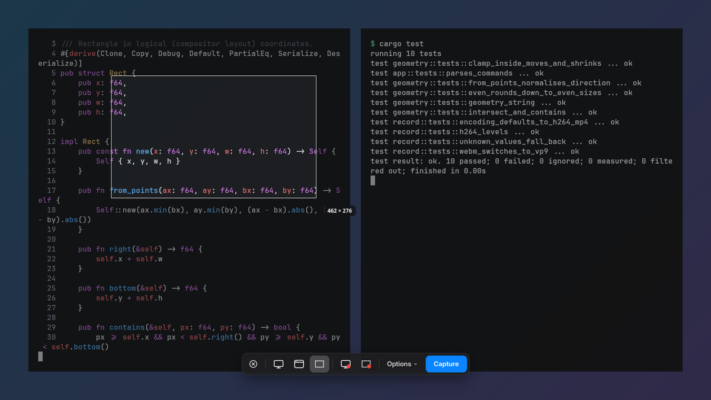
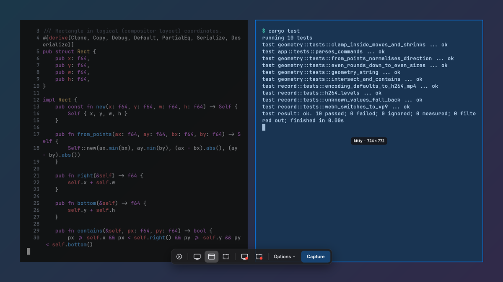
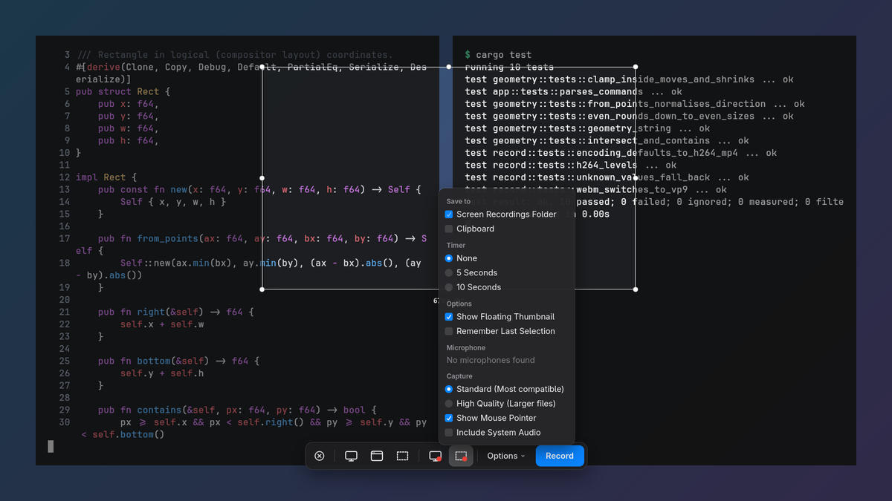
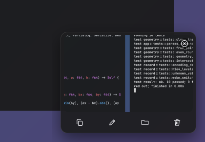

<div align="center">

# Nice Screenshots

**macOS-style screenshots and screen recording for Hyprland and sway.**



</div>

## Install

Paste this into Claude Code, Codex, Cursor or any coding agent. It installs everything and sets
up your shortcuts:

```
Install and set up nice-screenshots on this computer by following
https://raw.githubusercontent.com/chrischriscris/nice-screenshots/main/docs/agent-setup.md
Ask me before using sudo or changing my config files.
```

Or by hand: `paru -S nice-screenshots`, then [add the shortcuts](#shortcuts).

## Shortcuts

| Keys | Does | On macOS |
| --- | --- | --- |
| <kbd>Print</kbd> | Select a region (<kbd>Space</kbd> picks a window instead) | <kbd>⌘</kbd><kbd>⇧</kbd><kbd>4</kbd> |
| <kbd>Ctrl</kbd> <kbd>Print</kbd> | Toolbar: screenshots and recording | <kbd>⌘</kbd><kbd>⇧</kbd><kbd>5</kbd> |
| <kbd>Super</kbd> <kbd>Print</kbd> | Capture the whole screen | <kbd>⌘</kbd><kbd>⇧</kbd><kbd>3</kbd> |
| <kbd>Super</kbd> <kbd>Ctrl</kbd> <kbd>Esc</kbd> | Stop recording | <kbd>⌘</kbd><kbd>⌃</kbd><kbd>Esc</kbd> |

<details>
<summary>Hyprland config</summary>

```ini
bind = , Print, exec, nice-screenshots region
bind = CONTROL, Print, exec, nice-screenshots
bind = SUPER, Print, exec, nice-screenshots screen
bind = SUPER CONTROL, Escape, exec, nice-screenshots stop

# Optional: no fade on the frozen overlay, blur behind the floating UI (Hyprland 0.56 syntax)
layerrule {
    name = nice-screenshots-overlay
    match:namespace = ^(nice-screenshots|nice-screenshots-flash)$
    no_anim = on
}

layerrule {
    name = nice-screenshots-chrome
    match:namespace = ^(nice-screenshots-(thumbnail|indicator|countdown))$
    blur = on
    ignore_alpha = 0.3
}
```

</details>

<details>
<summary>sway config</summary>

```
bindsym Print exec nice-screenshots region
bindsym Ctrl+Print exec nice-screenshots
bindsym Mod4+Print exec nice-screenshots screen
bindsym Mod4+Ctrl+Escape exec nice-screenshots stop
```

</details>

## Features

- **Frozen screen** while you select: menus and tooltips stay put
- **Window picking**, with a highlight under the pointer
- **Floating thumbnail**: copy, mark up, show in folder, delete, or drag into any app
- **Recording** on the GPU, with mic and system audio, in files that play on WhatsApp, Slack and
  Discord
- **Stop button in your bar**, like the macOS menu bar
- Flash and shutter sound, size readout, resize handles, arrow-key nudging

| Window picking | Options | Thumbnail |
| --- | --- | --- |
|  |  |  |

## More

<details>
<summary>Commands and selection keys</summary>

```
nice-screenshots                 toolbar (run again to stop a recording)
nice-screenshots region          select a region; Space switches to window mode
nice-screenshots window          click a window
nice-screenshots screen          capture the focused screen now
nice-screenshots record-region   toolbar in region-recording mode
nice-screenshots record-screen   toolbar in screen-recording mode
nice-screenshots stop            stop recording
```

While selecting: drag the handles to resize or drag inside to move. Arrow keys nudge (Shift: 10
px, Alt: resize). Enter or double-click captures. Esc or right-click cancels.

Screenshots go to `~/Pictures/Screenshots` and the clipboard, recordings to
`~/Videos/Screen Recordings`.

</details>

<details>
<summary>Recording</summary>

The toolbar's **Options** menu picks the microphone, system audio, mouse pointer and quality:

- **Standard**: H.264 that keeps text sharp and files small.
- **High Quality**: 2.5× the bitrate, for fast motion.

`wl-screenrec` encodes on the GPU when a VA-API driver is installed; otherwise `wf-recorder` is
used. After stopping, the MP4 is fixed up without re-encoding so phones and chat apps play it.

</details>

<details>
<summary>Stop button in your status bar</summary>

While recording, `$XDG_RUNTIME_DIR/nice-screenshots/status.json` contains
`{"recording": true, "started": <unix time>, "path": "…"}`. Show a button that runs
`nice-screenshots stop`, then set `recording_pill = false` to hide the floating pill.

- **Quickshell**: copy [`extras/quickshell`](extras/quickshell) and add `ScreenRecording {}` to
  your bar.
- **Waybar**:

  ```json
  "custom/nice-screenshots": {
      "exec": "jq -r 'if .recording then \"⏹\" else \"\" end' $XDG_RUNTIME_DIR/nice-screenshots/status.json 2>/dev/null",
      "interval": 1,
      "on-click": "nice-screenshots stop",
      "tooltip": false
  }
  ```

</details>

<details>
<summary>Configuration</summary>

`~/.config/nice-screenshots/config.toml`; every key is optional.

```toml
screenshot_dir = "~/Pictures/Screenshots"         # default: $XDG_PICTURES_DIR/Screenshots
recording_dir = "~/Videos/Screen Recordings"      # default: $XDG_VIDEOS_DIR/Screen Recordings
screenshot_name = "Screenshot %Y-%m-%d at %H.%M.%S"
recording_name = "Screen Recording %Y-%m-%d at %H.%M.%S"
editor = "auto"            # satty, then swappy, then your image viewer; or a command with {}
recorder = "auto"          # "wl-screenrec" or "wf-recorder"
thumbnail_seconds = 6      # 0 keeps the thumbnail until dismissed
magnifier = false          # pixel magnifier next to the pointer while selecting
flash = true               # flash the captured area
sound = true               # play the camera shutter sound

recording_codec = "h264"   # "h264" (plays everywhere), "hevc" (smaller), "vp9" or "av1" (CPU)
recording_format = "mp4"   # "mp4", "mkv" (survives crashes) or "webm" (VP9/AV1 only)
recording_fps = 0          # cap the frame rate, e.g. 30; 0 = the display's refresh rate
recording_pill = true      # floating timer and stop button while recording
```

Toolbar options are remembered in `~/.local/state/nice-screenshots/options.json`.

</details>

<details>
<summary>Other ways to install, and dependencies</summary>

```sh
paru -S nice-screenshots-git    # latest commit
cargo install nice-screenshots  # needs GTK 4 + gtk4-layer-shell dev files, Rust 1.87+
```

| For | Packages (Arch names) |
| --- | --- |
| Everything | `gtk4` `gtk4-layer-shell` `grim` `wl-clipboard` |
| Recording | `wl-screenrec` (GPU, needs e.g. `intel-media-driver`) or `wf-recorder` |
| Share-friendly MP4s | `ffmpeg` |
| Mark up | `satty` or `swappy` |
| Mic and system audio | `libpulse` (works with PipeWire) |
| Shutter sound | `pipewire` `sound-theme-freedesktop` |
| Notifications | `libnotify` |

</details>

<details>
<summary>Compatibility</summary>

- **Hyprland, sway**: everything.
- **river, Wayfire, labwc, niri**: screenshots and recording should work; window picking doesn't.
- **GNOME, KDE Plasma, X11**: not supported yet.

GTK themes don't restyle it. There's no "Show Mouse Clicks", since Wayland doesn't let apps see
clicks outside their windows.

</details>

## License

[MIT](LICENSE-MIT) or [Apache 2.0](LICENSE-APACHE), at your option.
